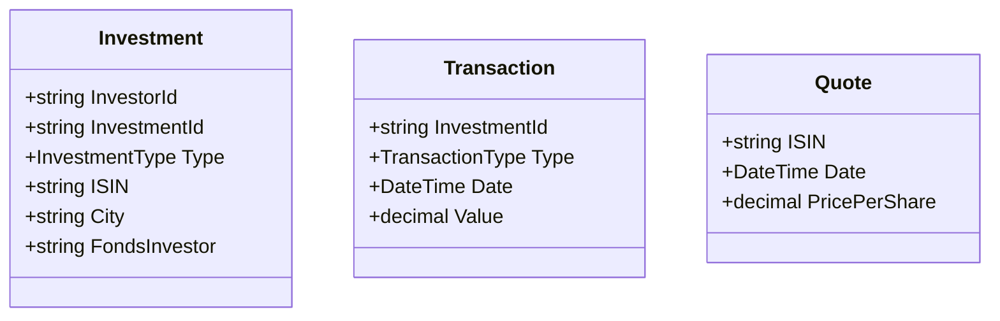

# Portfolio Calculator - README

## Overview

This solution calculates portfolio values for investors based on their investments in stocks, real estate, and funds. It processes large datasets efficiently while maintaining clean code practices and preventing circular references.

## Key Features

- Calculates portfolio value for a given investor on a given date
- Handles three investment types: Stocks, Real Estate, and Funds
- Processes large datasets (Almost 1M records) efficiently
- Detects and handles circular references in fund investments
- Provides detailed breakdowns of portfolio composition

## Architecture

### 1. Data Model



### 2. Calculation Logic

**Stock Valuation:**

```
Value = Shares Owned × Latest Price
Shares owned = Sum of all "Shares" transactions up to reference date
Latest price = Most recent quote on/before reference date
```

**Real Estate Valuation:**

```
Value = Land Value + Building Value
Land value = Sum of all "Estate" transactions
Building value = Sum of all "Building" transactions
```

**Fund Valuation:**

```
Value = Percentage Owned × Fund Value
Percentage owned = Sum of all "Percentage" transactions
Fund value = Sum of all underlying investment values
```

### 3. Performance Optimizations

**Data Structures:**

- Dictionary lookups for O(1) access to investments, transactions, and quotes
- Binary search for O(log n) lookup of latest quotes
- Concurrent collections (`ConcurrentDictionary`) for thread-safe caching

**Parallel Processing:**

```csharp
investorInvestments
    .AsParallel()
    .WithDegreeOfParallelism(Environment.ProcessorCount)
    .Select(inv => CalculateInvestmentValue(inv, context));
```

**Caching Strategy:**

- Cache investment values per date using `ConcurrentDictionary` to avoid redundant calculations

### 4. Memory Management

- Streaming CSV reading via `File.ReadLines`
- Lazy evaluation with `IEnumerable`
- Efficient grouping during initialization

## Clean Code Practices

### 1. SOLID Principles

- **Single Responsibility:** Each method does one thing
- **Open/Closed:** Easy to extend with new investment types
- **Liskov Substitution:** Consistent interfaces
- **Interface Segregation:** Focused interfaces
- **Dependency Inversion:** High-level modules don’t depend on low-level details

### 2. Code Organization

```
PortfolioCalculator/
├── Models/           # Data structures
├── Services/         # Business logic
├── Data/             # Data access
└── Program.cs        # Entry point
```

### 3. Error Handling

- Defensive programming with null checks
- Clear warning messages for circular references
- Graceful degradation for missing data

## Usage Example

```csharp
// Initialize calculator
var calculator = new CalculatePortfolio(investments, transactions, quotes);

// Calculate portfolio value
var portfolioValue = calculator.CalculatePortfolioValue("Investor54", new DateTime(2016, 6, 29));

// Output will show:
// - Total portfolio value
// - Breakdown by investment type
// - Individual investment values and percentages
// - Any warnings/errors
```

## Performance Characteristics

| Operation             | Complexity | Notes                          |
| --------------------- | ---------- | ------------------------------ |
| Data Loading          | O(n)       | Parallelizable                 |
| Investment Lookup     | O(1)       | Dictionary-based               |
| Quote Lookup          | O(log n)   | Binary search                  |
| Portfolio Calculation | O(m)       | Parallelized (m = investments) |
| Cache Lookup          | O(1)       | Concurrent dictionary          |

## Best Practices

### For Large Datasets:

- Use streaming reads for CSV files
- Consider batching for extremely large portfolios
- Monitor cache size in long-running processes

### For Accuracy:

- Verify quote date matching logic
- Double-check transaction type handling
- Test edge cases with zero values

### For Maintenance:

- Keep business logic separate from I/O
- Maintain clear method naming
- Document complex algorithms

### Execution Steps:

- Step 1: Build the solution: dotnet build PortfolioCalculator.sln
- Step 2: Run the application: dotnet run --project PortfolioCalculator/PortfolioCalculator.csproj
- Step 3: Run unit tests: dotnet test PortfolioCalculator.Tests/PortfolioCalculator.Tests.csproj

### Sample Output

```
=== Portfolio Value Calculator ===

Loading data files...
Data loaded successfully!

Enter investor details (or press Enter to exit)
---------------------------------------------
Investor ID: Investor0
Date (YYYY-MM-DD) or press Enter to exit: 2016-01-03

Portfolio Breakdown:

[RealEstate]
  - Investment26563: 2434595.00 (59.83%)
  - Investment27189: 1631813.00 (40.10%)

[Stock]
  - Investment11191: 1729.42 (0.04%)
  - Investment14629: 1240.23 (0.03%)

Portfolio Value for Investor Investor0 on 2016-01-03:
        4069377.66

Calculation time: 106 ms
```

## Conclusion

This solution provides an optimal balance between:

- **Correctness:** Accurate calculations with proper financial logic
- **Performance:** Efficient processing of large datasets
- **Maintainability:** Clean, well-organized code
- **Robustness:** Handles edge cases and errors gracefully
